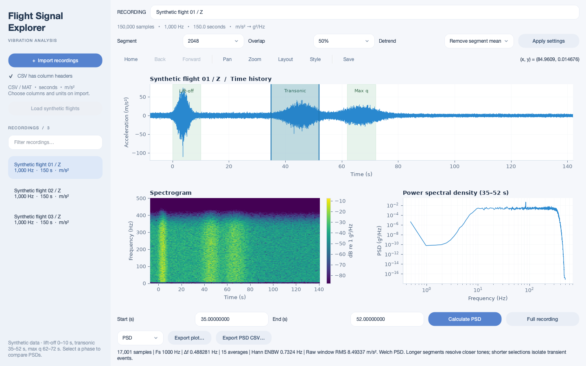

# LaunchDSP

LaunchDSP analyzes flight acceleration recordings using time histories, spectrograms, and calibrated PSDs. Use the self-contained browser app on a laptop or the Python desktop app. Recordings stay on your computer.

## Browser app — laptop edition

Download [web/LaunchDSP.html](web/LaunchDSP.html) using GitHub's **Download raw file** button and open it in a current laptop browser. No Python, MATLAB, installation, server, or internet connection is needed after download. The same HTML works as a static web page.

The browser workspace includes a file/import sidebar, CSV and supported MAT import, acceleration time history with scroll zoom and Home, full-recording spectrogram, selected-window log–log PSD, nearest-point hover readouts, and PNG/SVG/PSD CSV exports. Use **Print / PDF** for the browser's PDF export.

**Save run .DSP** exports the entire recording library and original samples, titles, units, per-recording analysis settings, selected intervals, zoom views, and active recording. **Open .DSP run** restores it for future reuse or transfer to another laptop. This session format is supported by the browser app; the existing Mac/Python build does not yet import it.

See the [browser guide](web/README.md) for workflow, import compatibility, and the versioned session format, and [browser validation](web/VALIDATION.md) for numerical and UI checks. Chrome on macOS was directly tested; other laptop platforms and browser engines have not been directly tested. All data must fit available browser memory.

## Run

Version 6 includes faster startup, a file sidebar, scroll zoom, Home view, PSD hover readouts, and log–log PSD plots.



### Standalone Mac app

Download the standalone Mac app from the [Mac app release](https://github.com/niyer45/LaunchDSP/releases/tag/app). Under **Assets**, select **FlightSignalExplorerApp** (approximately 162 MiB). This asset is a ZIP archive; if your browser saves it without an extension, add `.zip` before extracting it.

1. Unzip the download.
2. Move the extracted app to your **Applications** folder. The current release was built before the LaunchDSP rename and still uses **Flight Signal Explorer 6.app** and the earlier branding; source builds now use LaunchDSP.
3. Open the app and import your CSV or MAT recordings.

The standalone build includes Python and its dependencies; you do not need to install Python or MATLAB. This build is for **Apple Silicon Macs (arm64)**. Intel Mac users can run the Python source below. Access to the download requires a GitHub account with permission to view this private repository.

The Mac app is unsigned and not notarized, so macOS may require approval in **System Settings → Privacy & Security** on first launch.

### Run from Python source

The source works on macOS, Windows, and Linux with Python 3.11 or newer:

```sh
python -m venv .venv
# macOS/Linux
source .venv/bin/activate
# Windows instead: .venv\Scripts\activate
python -m pip install -r requirements.txt
python app.py
```

## Workflow

1. Choose **Import files…** and select multiple CSV or MAT files. For headerless text, uncheck **Files have column headers** first.
2. For each file, map the time column and select one or more acceleration columns. Defaults are **seconds** and **m/s²**. If time is absent, choose “No time column” and enter the sample rate in Hz. Each selected channel becomes a recording.
3. Click a recording in the left sidebar. Its time history appears above dedicated spectrogram and PSD panels. Switching recordings preserves each selection and analysis settings. Use the sidebar search to filter recordings.
4. Scroll up over the time history to zoom in around the pointer, and scroll down to zoom out. **Home** restores the full time and amplitude view without changing the PSD selection. Zooming redraws the visible samples at appropriate detail. Drag horizontally on the time-history plot. The highlighted interval updates the PSD. You can adjust the highlighted region, type exact start/end times, or use **Full recording**. Disable toolbar pan/zoom before selecting an interval.
5. Hover over the PSD to see the nearest visible computed sample in Hz and g²/Hz. The tooltip snaps by screen distance on the logarithmic axes; it does not interpolate. Adjust FFT segment length, overlap, and detrending, then click **Apply settings**.
6. Edit the plot title and use **Export plot…** for PNG, PDF, or SVG. Choose an individual plot or all three. **Export PSD CSV…** saves frequency, g²/Hz, interval, sample rate, spectral settings, source, and channel.

**Load synthetic flights** supplies three reproducible 150-second launch-like vertical recordings, with highlighted lift-off (0–10 s), transonic (35–52 s), and max-q (62–72 s) phases. They are illustrative random vibration, not measured flight data or a physical flight simulation.

The `sample_data` folder contains all three flights as CSV and MAT, each with `time_s`, `accel_x_m_s2`, `accel_y_m_s2`, and `accel_z_m_s2`. Each channel contains 150,000 samples at 1,000 Hz from −8 to 141.999 seconds. Import either format; they contain the same data. Run `python synthetic.py sample_data` to regenerate them. The image-inspired phase labels are illustrative; real imported recordings are not automatically classified by flight phase.

## Data format

CSV example:

```csv
time,accel_x,accel_y
0.000,0.12,-0.08
0.001,0.18,-0.06
0.002,0.10,-0.09
```

At least 16 finite samples are required. Time must be numeric, strictly increasing, and uniformly spaced within 1% of the median interval. Missing values and gaps are rejected; the app does not silently interpolate or drop samples. Use elapsed seconds rather than epoch timestamps for best precision.

MAT files support top-level numeric vectors of equal length (e.g., `time`, `accel_x`, `accel_y`) and numeric 2D matrices with samples in rows. Select the relevant table in the import dialog. Nested structs, timetables, and MATLAB v7.3/HDF5 files require export to CSV or a simpler MAT file first. Text delimiter detection handles common CSV/TSV files. XLSX sheets are also supported.

## Analysis conventions

- Time history retains the selected input acceleration units; the default is m/s².
- Spectral calculations convert acceleration to g using **1 g = 9.80665 m/s²**.
- PSD plots use logarithmic frequency and density axes (log–log). The 0 Hz/DC bin and nonpositive power values are omitted from plots; CSV exports retain all computed bins and original values.
- PSD: one-sided Welch estimate, frequency in **Hz**, density in **g²/Hz**, periodic Hann window, configurable overlap and detrending. Default: 4096 samples, 50% overlap, per-segment mean removal.
- Short selections use a segment no longer than the selected interval. The status line reports actual segment length and frequency-bin spacing Fs/N. Very short selections have coarse frequency resolution and fewer averages.
- Spectrogram: Hann-windowed density estimates in **dB relative to 1 g²/Hz**. Uses the same analysis settings over the full recording. The displayed color scale spans 80 dB below the peak; lower values are clipped visually. This does not alter PSD data.
- Raw-window RMS is reported in the input units and includes the mean; it is not the integral of the detrended PSD.
- Long time histories are drawn using a min/max envelope; PSD calculations always use the original samples. Long spectrograms display at most 1600 time slices, while computation uses the original samples.
- The PSD area stays empty until an interval is selected. Units, titles, axes, and spectrogram color scale are included in plot exports.

Analysis and file reading run in background workers. This version loads recordings into memory; it is intended for files that fit available RAM. The recording library and selections are held for the current session only. Each imported file has its own mapping dialog.

## Build a native app

Build on the operating system you want to distribute to. PyInstaller does not cross-compile:

```sh
python -m pip install pyinstaller
python -m PyInstaller --noconfirm --windowed --name "LaunchDSP" app.py
```

The macOS build included here is unsigned and built for this Mac's architecture. Distribution to other Macs may require signing/notarization. Windows users can run the source or build the Windows executable using the command above.

## Validation

```sh
python -m pip install pytest
python -m pytest tests
```

Tests cover acceleration-to-g calibration, integrated PSD power, known frequency peaks, interval-specific spectra, spectrogram density units, input validation, CSV/MAT import, and sample-rate-based time generation.

Numerical references: [SciPy Welch](https://docs.scipy.org/doc/scipy/reference/generated/scipy.signal.welch.html), [SciPy spectrogram](https://docs.scipy.org/doc/scipy/reference/generated/scipy.signal.spectrogram.html), [Matplotlib span selection](https://matplotlib.org/stable/gallery/widgets/span_selector.html).

## PSD peak clarity

The PSD calculation was verified against an independently coded FFT/Welch calculation (including detrending, odd/even segment sizes, and one-sided scaling), a calibrated 1 g RMS sine wave, and broadband noise variance. 21 numerical/import tests pass.

The UI now defaults to 4096 samples and allows up to 32768. At 1000 Hz the default bin spacing is 0.244 Hz (previously 0.977 Hz). Hann equivalent noise bandwidth is 1.5 times the bin spacing; the status line reports both bin spacing and bandwidth, plus the number of averaged segments. Longer segments sharpen narrow tones but give fewer averages and coarser spectrogram time resolution. Short selections cap the segment length and may contain only one average.

A time-history shock is broadband and need not appear as a narrow PSD peak. Whole-flight averaging also dilutes brief events. For the supplied Starship dataset, select 169–180 seconds to see the injected 115 Hz post-failure oscillation; compare 162–166 seconds before it. No smoothing, peak boosting, or amplitude renormalization is applied. All data bins remain available in CSV exports.

## Startup performance

The window opens before loading NumPy, SciPy, pandas, or Matplotlib. Empty chart panels use native widgets. These libraries load when you first open a recording; first-analysis initialization may therefore take a moment. The packaged one-folder app reuses its Matplotlib font cache in the application cache directory, isolated per installation path. Moving or renaming the app can require a new cache.

Startup measurements in `startup-benchmark.json` time fresh Python-process imports through the first rendered offscreen Qt window. They are indicative local measurements, not Finder-launch benchmarks; operating-system caching, machine load, and first-launch security checks affect actual launch time.

## Starship-style fault scenario

`sample_data/starship` includes a synthetic flight from prelift-off through separated flight, with normal throttle changes around max q, ship ignition, a smaller separation transient, and an injected Raptor failure. Both CSV and MAT are provided, together with the generator, event times, and annotated preview. All timings and amplitudes are illustrative.
